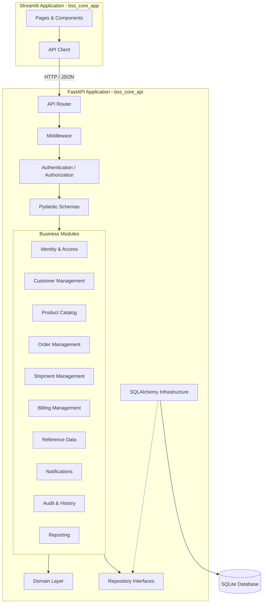
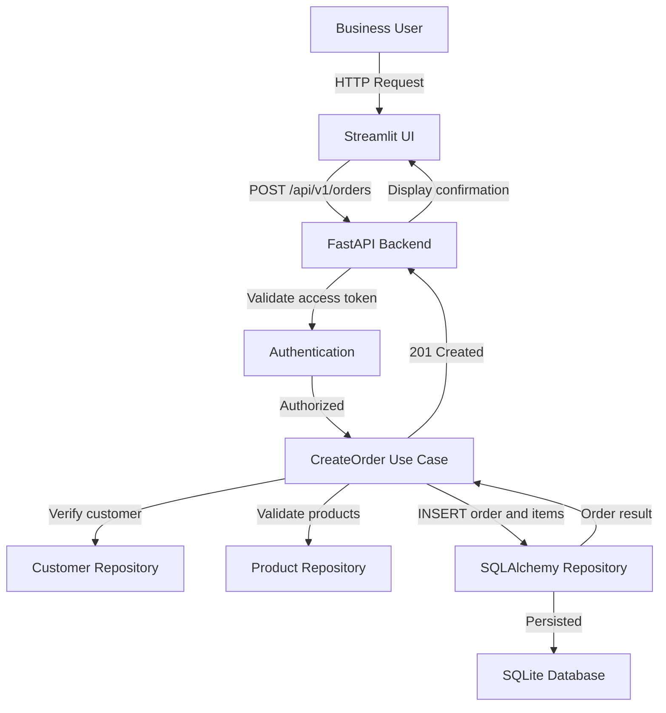
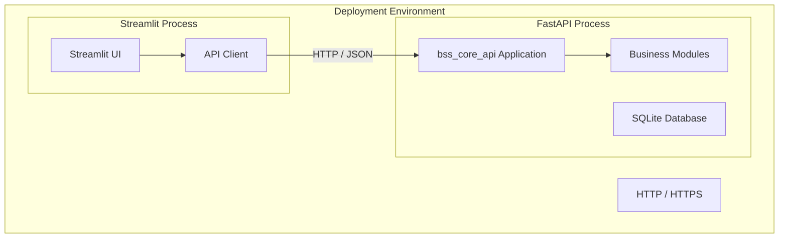

# System Architecture

**Project:** `bss-core`  
**Document:** `docs/architecture.md`  
**Status:** Proposed specification  
**Objective:** Define the technical architecture of bss-core before generating implementation code.

---

## 1. Architecture decisions

We will use a Modular Monolith with DDD and Clean Architecture.

The important distinction is:

- One backend application (FastAPI).
- Multiple independent business modules inside that application.
- One independent frontend application (Streamlit).
- One database initially (SQLite).
- No direct database access from Streamlit.
- No direct repository access across business modules.
- Each module has its own domain, application, infrastructure, and presentation responsibilities.

---

## 2. High-level system architecture



---

## 3. Application boundaries

### 3.1 Backend — `bss_core_api`

The backend is the central business application.

**Responsibilities:**

- Expose REST APIs.
- Authenticate users.
- Authorize operations.
- Execute business use cases.
- Enforce business rules.
- Manage database transactions.
- Coordinate interactions between modules.
- Publish audit events.
- Validate incoming requests.
- Return consistent API responses.

The backend owns all business operations and data access.

### 3.2 Frontend — `bss_core_app`

The frontend is an independent Streamlit application.

**Responsibilities:**

- Login and logout interfaces.
- Dashboard and navigation.
- Customer management screens.
- Product management screens.
- Order management screens.
- Shipment management screens.
- Billing management screens.
- User administration screens.
- Reporting and visualization.

**The frontend MUST:**

- Communicate through HTTP APIs.
- Keep presentation logic separate from API communication.
- Handle loading, validation, and API errors.
- Never implement authoritative business rules.
- Never import backend repositories or database models.

### 3.3 Data generator — `tools/data_generator`

The data generator is a development utility, not a production business module.

**Responsibilities:**

- Generate customers.
- Generate products and services.
- Generate orders and order items.
- Generate shipments and tracking records.
- Generate invoices and payments.
- Generate users and roles.
- Generate consistent relationships between records.

**It MUST support:**

- Configurable record volumes.
- Reproducible datasets using random seeds.
- Clean database initialization.
- Referential integrity.
- Different data scenarios.

---

## 4. Business module architecture

Every business module follows the same internal structure.

```mermaid
flowchart TB
    subgraph PRESENTATION["Presentation Layer"]
        PydanticSchemas["Pydantic Schemas"]
        HTTP["HTTP Request / Response"]
    end

    subgraph APPLICATION["Application Layer"]
        UseCases["Use Cases"]
        DtoMapping["DTO / API Mapping"]
        RepositoryInterfaces["Repository Interfaces"]
    end

    subgraph DOMAIN["Domain Layer"]
        Aggregates["Aggregate Roots"]
        Entities["Entities"]
        ValueObjects["Value Objects"]
        DomainServices["Domain Services"]
        BusinessRules["Business Rules"]
    end

    subgraph INFRASTRUCTURE["Infrastructure Layer"]
        RepoImpl["SQLAlchemy Repository"]
        Models["SQLAlchemy Models"]
        Session["Session Management"]
        Migrations["Alembic Migrations"]
    end

    direction BT
    Presentation --> Application
    Application --> Domain
    Application --> Infrastructure
    Infrastructure --> Database

    The dependency direction is inward:
    Presentation
         |
         v
    Application
         |
         v
    Domain

    Infrastructure implements interfaces
    defined by the inner layers.

    Important: Infrastructure can depend on the domain and application layers,
    but the domain must never depend on infrastructure.
```

---

## 5. Business module responsibilities

| Module | Owns | Important relationships |
|---|---|---|
| Identity & Access | Users, roles, permissions, sessions | All modules |
| Customer Management | Customers, contacts, addresses | Orders, billing |
| Product Catalog | Products, services, prices | Orders |
| Order Management | Orders, order items, lifecycle | Customer, products, shipment, billing |
| Shipment Management | Shipments, packages, tracking | Orders, customers |
| Billing Management | Invoices, invoice lines, payments | Customers, orders |
| Reference Data | Countries, currencies, statuses | All modules |
| Notifications | Notification records and delivery status | All modules |
| Audit | Audit events and history | All modules |
| Reporting | Operational and financial insights | Read-only across modules |

**Each module owns its database tables.**

Other modules MUST NOT modify those tables directly.

---

## 6. Module communication

We will distinguish three types of communication.

### 6.1 Synchronous communication

Used when a module needs an immediate result from another module.

**Example:**

An order creation use case needs to verify that the customer exists and is eligible to place an order.

```text
Order Management
       |
       v
Customer Application Interface
       |
       v
Customer Use Case
       |
       v
Customer Repository
```

The Order module must not query the Customer repository directly.

### 6.2 Domain events

Used to communicate business events without creating unnecessary dependencies.

**Examples:**

| Event | Producer | Potential consumers |
|---|---|---|
| CustomerCreated | Customer | Audit, Notifications |
| OrderCreated | Order | Audit, Billing |
| OrderConfirmed | Order | Shipment, Billing |
| ShipmentDispatched | Shipment | Notifications, Audit |
| ShipmentDelivered | Shipment | Notifications, Billing |
| InvoiceIssued | Billing | Notifications, Audit |
| PaymentReceived | Billing | Notifications, Audit |

Initially, domain events can be dispatched in-process.

For reliable event processing, we will introduce an outbox mechanism when the requirements justify it.

### 6.3 Cross-module transaction boundaries

Transactions must be owned by the application use case that coordinates the operation.

**Example:** Confirming an order may require:

1. Validate the order.
2. Confirm customer eligibility.
3. Validate order items.
4. Change order status.
5. Record the business event.

We must explicitly define which operations share a database transaction and which are handled asynchronously.

---

## 7. Complete request lifecycle

**Example:** A user creates an order through Streamlit.



This is the expected architecture for all user-facing business operations.

---

## 8. Database architecture

Initially, all modules share one SQLite database file, but their table ownership remains separate.

**Logical organization:**

```text
bss_core.db
│
├── iam_users
├── iam_roles
├── iam_permissions
│
├── customers
├── customer_contacts
├── customer_addresses
│
├── products
├── product_prices
│
├── orders
├── order_items
│
├── shipments
├── shipment_tracking
│
├── invoices
├── invoice_items
├── payments
│
├── reference_countries
├── reference_currencies
│
└── audit_events
```

**Database rules:**

- SQLAlchemy 2.x.
- Alembic migrations.
- Explicit foreign keys.
- UTC timestamps.
- Decimal-based monetary values.
- Explicit transaction management.
- Repository pattern.
- No ORM entities exposed through API responses.

SQLite is suitable for initial development and a single-instance deployment. If concurrent write workloads or multi-instance deployment become requirements, we will evaluate PostgreSQL.

---

## 9. Security architecture

**Security requirements:**

- Password hashing with Argon2id.
- JWT access tokens.
- Token expiration and refresh strategy.
- Role-based access control.
- Permission checks on backend operations.
- Protected administrative operations.
- Audit trail for sensitive operations.
- Secret management through environment configuration.

Roles and permissions must be enforced by FastAPI, not Streamlit.

```mermaid
flowchart TB
    UserLogin -->|Authentication Service| Argon2id Password Verification
    -->|JWT Access Token| Authorization RBAC
    -->|Permission Check| Business Use Case
    -->|403 Forbidden| Authorized
    -->|Denied
```

---

## 10. Deployment architecture

Initially, the system can run as two independent processes.



The processes can be started independently:

```bash
# Terminal 1: Backend
uv run uvicorn bss_core_api.main:app --reload

# Terminal 2: Frontend
uv run streamlit run bss_core_app/main.py
```

Both applications will use environment-based configuration.

---

## 11. Architecture constraints for the LLM

The coding agent MUST respect the following constraints:

| ID | Constraint |
|---|---|
| ARC-001 | Backend and frontend are independent applications. |
| ARC-002 | Streamlit communicates only through HTTP APIs. |
| ARC-003 | Backend follows modular monolith architecture. |
| ARC-004 | Every business module owns its domain. |
| ARC-005 | Domain layer has no framework dependencies. |
| ARC-006 | Business rules belong in domain/application layers. |
| ARC-007 | Infrastructure implements repository interfaces. |
| ARC-008 | Cross-module access uses explicit interfaces. |
| ARC-009 | Database access is restricted to backend infrastructure and approved development tooling. |
| ARC-010 | API contracts use Pydantic schemas. |
| ARC-011 | All business operations have automated tests. |
| ARC-012 | Modules are delivered as complete vertical slices. |
| ARC-013 | Database migrations are managed with Alembic. |
| ARC-014 | Authentication and authorization are enforced by the backend. |
| ARC-015 | No microservices without an approved architecture decision. |

---

## 12. Architecture acceptance criteria

The architecture is accepted when:

- [ ] Backend and frontend have independent entry points.
- [ ] Each business module has clearly defined ownership.
- [ ] Clean Architecture dependency rules are documented.
- [ ] Cross-module communication rules are documented.
- [ ] Database ownership is documented.
- [ ] Authentication and authorization boundaries are defined.
- [ ] Data generation has a defined architectural boundary.
- [ ] Deployment model is documented.
- [ ] Architecture constraints are available to the coding agent.

---

## 13. S07 consolidated runtime

`src/api/health.py` is the single composition root. It mounts the customer,
order, shipment, dashboard, invoice, and payment routers and registers the
standardized error handlers.

Cross-module workflows use application adapters rather than ORM access:

```text
order_management  <-- OrderModuleAdapter -- shipment_management
order_management  <-- OrderModuleAdapter -- billing_management
customer_management <-- CustomerEligibilityAdapter -- order_management
```

Each module owns its SQLAlchemy `Base`/metadata. Migrations import every
module's metadata so `alembic upgrade head` creates the full schema in FK
dependency order: customers → orders → shipments → invoices → payments.
